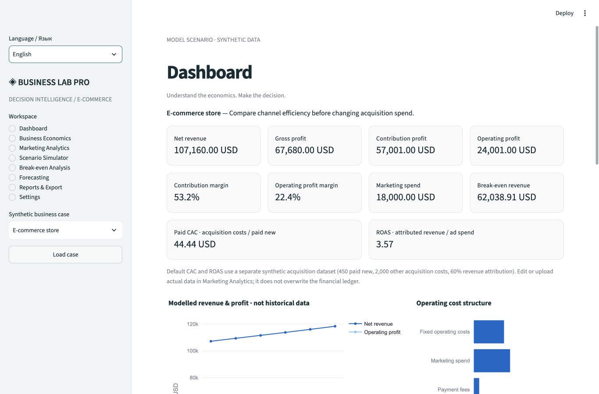
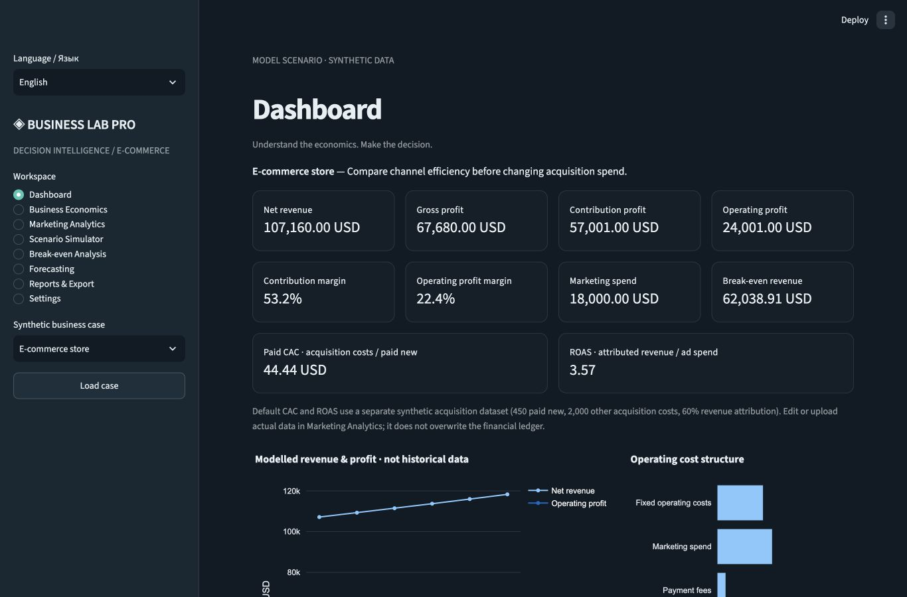

# BUSINESS LAB PRO

**Transparent e-commerce economics, marketing measurement and scenario planning.**

A local-first Python/Streamlit application for answering: *How would this decision change operating profit, break-even and acquisition efficiency?* Four reproducible synthetic businesses make it usable immediately without accounts, API keys or paid services.

## Run locally

Python **3.14** was verified on macOS (Apple Silicon). Use the same minor version for the pinned dependency set.

```bash
git clone https://github.com/DmitryDeveloper3/business-lab-pro.git
cd business-lab-pro
python3 -m venv .venv
source .venv/bin/activate
python -m pip install -r requirements.txt
python -m streamlit run streamlit_app.py
```

Open the local URL printed by Streamlit. For a loopback-only server add `--server.address 127.0.0.1`. On macOS, `zsh Launch.command` starts the existing project environment; run `chmod +x Launch.command` first if you prefer launching it from Finder. First install the dependencies above.

## What works

| Workspace | Decision support |
|---|---|
| Dashboard | Revenue, gross/contribution/operating profit, margins, acquisition KPIs, cost structure and model trends |
| Business Economics | Validated monthly inputs, discounts, returns, fees, processing, fixed costs and other income |
| Marketing Analytics | Paid/organic new customers, repeat buyers, separate orders, CTR, CPC, CPA, paid/blended CAC, ROAS, CSV validation and channel screening |
| Scenario Simulator | Interactive alternative, pessimistic/base/optimistic comparison, CAC saturation, elasticity, repeat-order uplift and ±10% one-factor sensitivity |
| Break-even Analysis | Fractional break-even, minimum whole orders, revenue/cost intersection and price/overhead sensitivity |
| Forecasting | 3/6/12-month deterministic forecasts with demand, conversion, budget, COGS and overhead growth plus optional synthetic seasonality |
| Reports & Export | KPI and forecast CSV, versioned scenario JSON import/export, saved user comparisons and self-contained printable HTML |
| Settings | Formula order, model boundaries, synthetic case library and language/theme guidance |

The app supports English and Russian labels, chart titles, explanations and case narratives. Use the sidebar language selector. Light/dark appearance and USD/EUR/RUB currency selection are available directly in the sidebar. Appearance is session-local, including charts and table cells; it does not change the server-wide theme. Currency relabels the current baseline without FX conversion; saved scenarios keep their currencies. The layout stacks controls and KPI cards on narrow screens.

## Screenshots

Actual browser captures from local QA:





## Ten additional functions (v1.1), plus CSV export

1. **Persistent project library:** save/load financial baselines, alternatives, assumptions and analysis inputs in `.local/workspace.sqlite3`. Saves are explicit; choose whether to create a new project or update the active one. Financial model/input JSON backup can be restored on another installation.
2. **Decision journal:** record a decision, evidence/hypothesis, next review step and observed result against a saved project. The journal persists in SQLite and exports separately as CSV; it is not embedded in the model/input JSON backup.
3. **SKU economics:** editable/importable product rows with independent revenue, contribution and margin calculations. Synthetic templates never overwrite the current company baseline.
4. **Product portfolio:** consolidate SKU results, allocate shared ads/overhead by net revenue or order volume, and reconcile company profit without double-counting costs. With a zero allocation base, costs remain unallocated in the total.
5. **Profit target solver:** required orders, minimum whole orders, price at fixed demand and ad ceiling at fixed volume. Each answer is a separate conditional inverse calculation, not a demand prediction.
6. **Plan versus actual:** calendar-month actual CSV/editor with operating cost reconciliation and absolute/relative variances. Missing actual months are N/A, not zero. The initial zero row is a template, not measured history.
7. **Acquisition allowance:** maximum contribution-based CAC, direct ad allowance and purchase-count payback over an explicit user purchase horizon. This is not LTV and does not allocate company overhead to customers.
8. **Cash reserve/runway:** separately entered cash receipts/payments, reserve breaches and monthly cash balances. Profit is never silently treated as cash flow; initial cash plus constant monthly flows is the model.
9. **Synthetic risk stress test:** seeded Monte Carlo with independent triangular price, cost, conversion and CAC factors, sample profit quantiles and model loss frequency. Distribution assumptions are not calibrated probabilities for real businesses.
10. **Promotion viability:** compare a discount, assumed order uplift and incremental campaign cost; solve the volume needed to preserve baseline operating profit. Demand response is a stated assumption.

**CSV is available from every page** through the sidebar scenario download, from each advanced table, and from the Reports & Export **CSV export center**. Select one table or download all available tables in a ZIP with `manifest.json`. UTF-8 BOM supports Cyrillic in Excel; names/notes that resemble formulas are escaped while numeric values remain numeric. Stable technical column identifiers are used in CSV. Currency/period and per-analysis source-baseline metadata are preserved; stale analyses are flagged rather than silently relabelled. Visit an analysis workspace to add its tables to the bundle; scenarios, inputs and an explicitly labelled default forecast are always present.

Rebuild the synthetic examples with `python scripts/build_advanced_examples.py`. See `examples/business_lab_example.csv`, `examples/business_lab_csv_examples.zip`, `examples/product_input.csv` and `examples/actual_input.csv`. All are synthetic demonstrations.

The `.local/` database is ignored by Git. Override its directory with `BUSINESS_LAB_DATA_DIR` if needed. Local projects are shared by sessions on this installation; cloud persistence requires an appropriate storage architecture before real multi-user deployment. No new dependency is needed for SQLite.

## Architecture

```text
streamlit_app.py         UI, session state and chart composition
business_lab/
  models.py             Immutable validated Business and Marketing inputs
  engine.py             Pure economics, marketing, scenario, sensitivity and forecast functions
  storage.py            Strict JSON schema and channel-month CSV ingestion
  cases.py              Four deterministic synthetic businesses
  i18n.py               Shared translations for metrics, controls and reports
  report.py             Escaped, self-contained HTML reporting
  analytics.py          SKU/portfolio, inverse goals, CAC, cash, risk, plan/actual, promotions
  workspace.py          Explicit SQLite saves, journal and validated model/input backups
  workbench.py          Localized advanced workspaces
  exports.py            BOM CSV, spreadsheet text protection and ZIP bundles
examples/               Scenario JSON, CSV, ZIP; HTML reports generated locally
scripts/build_examples.py   Rebuild portfolio examples from the engine
tests/                  Numerical, validation, persistence, report and Streamlit interaction tests
```

The pure engine has no Streamlit dependencies. `Business` currently represents blended e-commerce orders, not a general ledger. Future SaaS/services adapters can supply their own operating drivers and reuse results/reporting; recurring subscription revenue, churn and cohort accounting require new explicitly tested models.

## Mathematical contract

All money is in a single selected currency (USD/EUR/RUB), per **month**, excluding VAT. Rates are fractions: `0.05 = 5%`. Changing currency changes the label; it does not convert values.

For placed orders `Q`, return/cancellation fraction `r`, basket price `P`, discount `d`, fulfilled-order COGS `C`, processing per placed order `V`, payment rate `f`, advertising `A`, overhead `F`, and other operating income `I`:

```text
Fulfilled orders       = Q × (1 − r)
Net revenue            = Q × (1 − r) × P × (1 − d)
COGS                   = Q × (1 − r) × C
Gross profit           = net revenue − COGS
Processing             = Q × V
Payment fees           = net revenue × f
Contribution profit    = gross profit − processing − payment fees
Operating profit       = contribution profit − A − F + I
Contribution / order u = (1 − r) × [P × (1 − d) × (1 − f) − C] − V
Break-even orders      = max(0, A + F − I) / u, when u > 0
Break-even net revenue = break-even orders × (1 − r) × P × (1 − d)
```

Gross profit excludes payment and processing costs; contribution excludes advertising and overhead. **No cost is subtracted twice.** Return stock is assumed fully recoverable, payment fees fully refunded, and processing non-refundable. These assumptions may not fit real return logistics. Other income is fixed; the intersection chart includes it, while the revenue KPI excludes it. For nonpositive unit contribution there is no sustainable volume-based break-even; the zero-burden/zero-margin case has break-even at zero. Whole orders are rounded upward. No division by zero: undefined KPIs are N/A.

Paid CAC uses `(direct ads + other paid acquisition costs) / paid new customers`. Blended CAC uses the same *measured* cost pool divided by all new customers; unmeasured organic acquisition costs are excluded. Order CPA uses `direct ads / all orders` and is labelled as a blended cost per order. ROAS uses *attributed advertising revenue*, not total business revenue. Rates show their denominator. Read the acquisition ledger separately from the financial ledger: other acquisition expenses are not silently added to or subtracted from the financial model. Include them in the appropriate financial overhead/processing input when modelling company profit.

### Scenario response

For budget factor `B`, paid CAC factor `K`, saturation `s`, conversion factor `c`, paid order share `p`, price factor `z`, price elasticity `ε`, repeat uplift `h`:

```text
Paid orders = baseline orders × p × B / [K × (1 + s × max(0, B − 1))] × c
Total orders = [paid orders + baseline orders × (1 − p)] × z^(−ε) × (1 + h)
```

Saturation is a user assumption, not a universal marketing law. Conversion and CAC are independent stress adjustments: do not count the same efficiency change twice. Uplift models incremental repeat *orders*, not retention or LTV. A zero baseline ad budget requires paid share zero because the acquisition response is unidentified.

Forecast month 1 equals baseline. At elapsed month `t`, budget, conversion, unit COGS and overhead multiply by their respective `(1 + growth)^t`; acquisition follows the saturation model. Demand then multiplies total orders by `(1 + demand growth)^t × [1 + amplitude × sin(2πt/12)]`. The seasonal phase is synthetic. There are no statistical prediction intervals or ML claims.

## Demonstration cases

All inputs are **synthetic**, denominated in USD per month, and are not market benchmarks. Exact computed outputs are in [`examples/case_results.csv`](examples/case_results.csv).

1. **E-commerce store** — compare increasing advertising by 20%, keeping a blended product margin and organic demand fixed.
2. **Unprofitable campaign** — a high advertising burden makes the baseline unprofitable; compare reducing spend by 30% while acquisition volume responds.
3. **Scaling decision** — double advertising; the default saturation coefficient increases effective CAC by 25% at that scale.
4. **Pricing strategy** — increase basket price by 15% with price elasticity 1.5; demand is allowed to fall.

Each case has starting inputs, a decision, calculated comparison and an explicit risk explanation in the UI. Load a case in the sidebar. Any subsequent manual changes become the current baseline; the case title remains contextual.

## Files and privacy

- Financial scenarios export with schema version 1 and strict field validation. JSON stores realized financial inputs, not a forecast engine or all interactive settings. Export **decision assumptions** separately to preserve scenario drivers. Imported realized scenarios have unknown original demand assumptions and the report says so.
- Unsaved comparisons live in browser session memory. Save the project explicitly or export before closing. Unsaved changes stay in the session. Explicit project saves use local SQLite; there is no account system. The local database is shared by sessions of this installation and cloud disk is not guaranteed durable.
- CSV uploads are limited to 5 MB and processed in memory. Validated product/actual inputs are written to the local database only when explicitly saving a project. No paid API, LLM or analytics service is called; Streamlit usage telemetry is disabled.
- A single month and currency per marketing CSV are required. Column names must match [`examples/marketing.csv`](examples/marketing.csv). Missing/negative/non-finite values, duplicated channel-month records, inconsistent funnels and mixed periods/currencies are rejected. Customers must be deduplicated across channels upstream; the app cannot establish identity from aggregates.
- The marketing funnel ends at **new customers**; repeat customers and orders are displayed separately because order counts can exceed customers. The model is explicitly lead-based; businesses without leads should adapt the acquisition model rather than fabricate leads.
- HTML reports embed Plotly JS and can be opened offline; use browser Print to save a PDF manually. No automated PDF export is claimed.

## QA

```bash
python -m pytest -q
ruff check .
ruff format --check .
python -m pip check
python scripts/build_examples.py
```

Tests include hand-computed finance, reconciliation, margin/loss edge cases, zero denominators, funnel validation, acquisition saturation, elasticity, forecasts, malformed JSON/CSV, self-contained HTML and actual Streamlit AppTest interactions in both languages. CI is configured in `.github/workflows/qa.yml`; the published project passed the [Linux/Python 3.14 QA run](https://github.com/DmitryDeveloper3/business-lab-pro/actions/runs/39755510198).

See [`docs/QA.md`](docs/QA.md) for verified checks and remaining gaps, [`docs/ARCHITECTURE.md`](docs/ARCHITECTURE.md) for implementation decisions and [`README_RU.md`](README_RU.md) for a Russian quick start.

## Deployment to Streamlit Community Cloud

Source repository: [DmitryDeveloper3/business-lab-pro](https://github.com/DmitryDeveloper3/business-lab-pro). Hosting uses Streamlit Community Cloud; see [deployment coordinates](docs/DEPLOYMENT.md).

1. Review the files and synthetic example reports. Keep `.venv`, cache folders and `.streamlit/secrets.toml` ignored.
2. Use the published repository above, or fork it into your own account. Keep the application files at repository root.
3. In Streamlit Community Cloud, select that repository, your chosen branch and `cloud_app.py` as the entrypoint. If the repo contains the parent folders, use `Python/BUSINESS_LAB_PRO/cloud_app.py` and ensure the dependency/config discovery follows that layout; a dedicated root repo is recommended.
4. Select Python 3.14, matching this verified lock. If unavailable, validate another Python version and regenerate its lock rather than assuming compatibility.
5. No secrets are required. Check both languages, data import/export and scenario calculations in the deployed environment before sharing the URL.

Local dependency support was checked against [Streamlit's supported Python versions](https://docs.streamlit.io/knowledge-base/using-streamlit/sanity-checks) and resolved from [PyPI](https://pypi.org/project/streamlit/). The installed package set is pinned in `requirements.txt`.

## Limits

This is a monthly operating decision-support MVP, not bookkeeping or investment advice. The operating engine does not calculate net profit, tax, working capital, inventory financing, refund timing, capacity constraints, causal attribution, observed historical trends, LTV or cohort retention. Cash flow has a separate constant-flow scenario using explicit receipts/payments; it is not inferred from profit. Channel contribution is a screening proxy based on blended financial margins and assumes net attributed revenue; shared overhead is excluded. Rule-based warnings explain evidence and caveats, not guaranteed profit improvements. Forecasts and synthetic demonstrations are scenarios, not predictions.

## Public demo entrypoint

Deploy **cloud_app.py** on Streamlit Community Cloud. It runs the same application with `BUSINESS_LAB_PUBLIC_DEMO=1`: each visitor session receives a separate random server-side workspace directory. Visitors cannot enumerate another session's saved projects through the project library. Session storage can disappear after restart; use model/input JSON and journal CSV downloads. This is a no-account public demonstration, not durable multi-user storage. The local `Launch.command`/`streamlit_app.py` workflow retains its explicit local SQLite persistence. Never upload `.local/`, `.venv/`, secrets or personal datasets to the repository.
